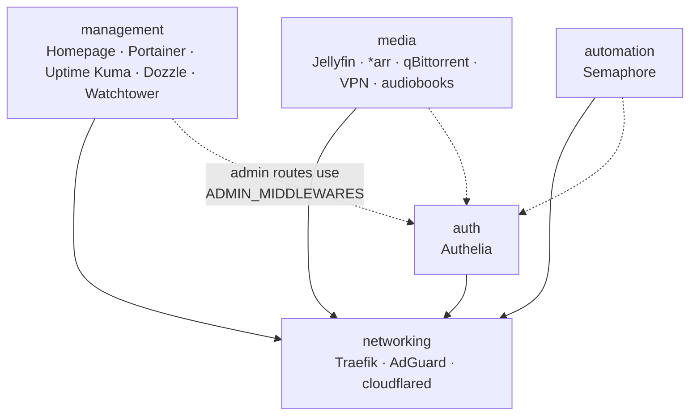
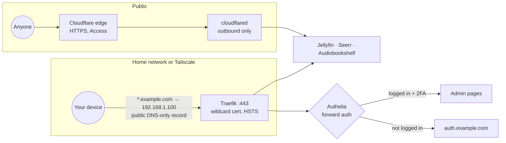
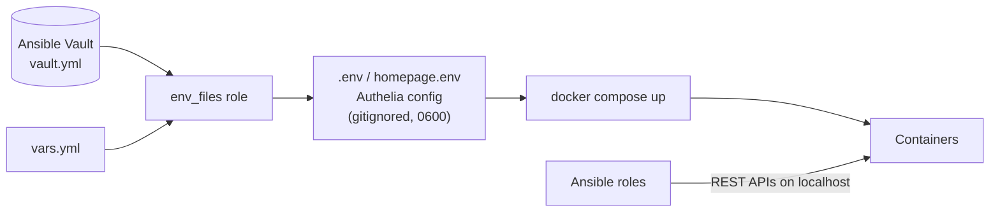

# Architecture

## Stacks

| Stack | Services | Purpose |
|-------|----------|---------|
| **docker-networking-stack** | Traefik, AdGuard Home, cloudflared *(optional `tunnel` profile)* | How traffic gets in: reverse proxy, TLS, security headers, DNS, public tunnel |
| **docker-auth-stack** | Authelia | Who is allowed in: one login with two-factor for every admin page |
| **docker-management-stack** | Homepage, Portainer, Watchtower, Uptime Kuma, Dozzle | Watching and running the server: start page, containers, monitoring, logs, auto-updates |
| **docker-media-stack** | Jellyfin, Sonarr, Radarr, Prowlarr, qBittorrent, Seerr, FlareSolverr, Gluetun VPN, Recommendarr, Shelfmark, Audiobookshelf | Media acquisition, streaming and audiobooks |
| **docker-automation-stack** | Semaphore, PostgreSQL | Ansible UI for running playbooks from a browser |

## Stack layout

Each stack has one purpose, and dependencies only point down the list. Arrows point at what a stack depends on; dotted ones are optional:

1. **networking** is the foundation. Every route goes through its Traefik, and it depends on no other stack, so it works on its own as a reverse proxy, DNS and tunnel setup.
2. **auth** puts Authelia in front of admin pages. It's optional: the link from other stacks is one setting, `traefik_admin_middlewares`, which can point at basic auth instead.
3. **management** looks after the other stacks. Nothing depends on it. Homepage lives here rather than in networking because its widgets need every app's API keys.
4. **media** is the apps. It needs networking only for its `*.domain` URLs.
5. **automation** is Semaphore, which runs the same Ansible playbooks from a browser.

`make deploy-all` deploys in this order and `make down-all` stops them in reverse. The reasoning is in [ADR 0007](decisions/0007-stack-layout.md).

## Three ways in

- **Public, through Cloudflare Tunnel:** only Jellyfin, Seerr and Audiobookshelf. `cloudflared` connects out to Cloudflare, so the router has no open ports.
- **Home network:** a public, DNS-only `*.domain` record points at the server's private IP, so every device finds these names with the DNS it already uses ([ADR 0006](decisions/0006-public-dns-only-wildcard.md)).
- **Away from home:** Tailscale routes the server's private IP to your own devices, so the same URLs work anywhere ([ADR 0010](decisions/0010-tailscale-remote-access.md)).

## Network

All stacks share one external Docker network, `homelab-network` (`172.20.0.0/16`), so Traefik can reach any container by name.

- **VPN namespace:** qBittorrent, Prowlarr and FlareSolverr use `network_mode: "service:vpn"`. They share Gluetun's network stack, so their traffic can only leave through the VPN, and their ports and Traefik labels sit on the Gluetun container.
- **Static IPs:** Radarr (`.200`) and Sonarr (`.201`), so Prowlarr can reach them from inside the VPN namespace, and Traefik (`.202`), so qBittorrent can trust requests that already passed Authelia. They're at the top of the subnet, away from Docker's dynamic allocation.
- **Docker Desktop source IPs:** traffic from the host or the LAN reaches containers from the gateway `172.20.0.1`, so whitelisting the subnet anywhere would whitelist the whole LAN ([ADR 0003](decisions/0003-qbittorrent-port-sync-and-auth.md)).

## TLS and headers

- Traefik gets **one wildcard certificate** (`domain` + `*.domain`) from Let's Encrypt with the Cloudflare DNS-01 challenge. Only the Traefik dashboard router requests it; the `websecure` entrypoint has TLS on, so every other router reuses it. Individual hostnames stay out of public Certificate Transparency logs ([ADR 0005](decisions/0005-one-wildcard-certificate.md)).
- A `security-headers` middleware on the entrypoint adds **HSTS** (6 months, subdomains, no preload), `nosniff` and a strict referrer policy to every route. Cloudflare adds HSTS to the tunnel hostnames.
- The DNS-01 challenge queries `1.1.1.1` and `8.8.8.8` directly, so AdGuard's local rewrites can't interfere with it.

## Configuration flow

Ansible runs on the host, not in Docker, so roles call services at `http://localhost:<port>`. Uptime Kuma and Homepage run inside Docker and use container names instead.
