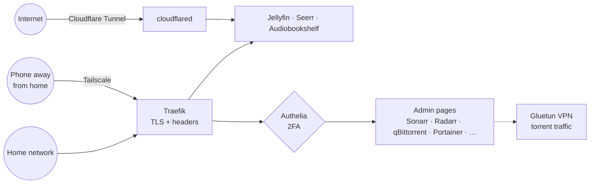

# HomeLab

A self-hosted media server on a Mac mini, run entirely as code. 22 containers in five Docker Compose stacks are deployed with `make`, then configured through their REST APIs by Ansible, with every secret in Ansible Vault.

These docs are both the operating manual and a write-up of how the system was designed, secured and built.

## Highlights

**Infrastructure as code**

- **Two layers:** Docker Compose provisions; 17 Ansible roles configure services over their APIs (download clients, indexer sync, DNS rewrites, monitors, single sign-on settings).
- **Reproducible:** a fresh machine reaches a working setup with `make generate-creds`, `make deploy-all` and `make ansible-sync`. Every step is idempotent, so re-running only changes what drifted.
- **Declarative:** routing is Docker labels, service settings are Ansible variables, the start page is committed YAML.

**Security**

- **Zero open router ports.** Public apps go through an outbound Cloudflare Tunnel; admin access away from home goes through Tailscale.
- **One login with two-factor** (Authelia) in front of every admin page, failing closed if Authelia is down. Admin ports listen on loopback only, so the LAN can't skip it.
- **TLS everywhere** from one Let's Encrypt wildcard certificate (DNS-01), plus HSTS and security headers on every route.
- **Secrets never touch git:** Ansible Vault is the single source of truth, `.env` files are generated with mode 0600, and CI runs gitleaks on every push.
- **Least privilege:** torrent traffic is confined to a VPN network namespace; the start page has no Docker socket and its API keys are loaded by that one container only; every container runs with `no-new-privileges`, enforced in CI.

**Modularity**

- Five stacks, each with one purpose and dependencies that only point one way, so each stack is usable on its own ([ADR 0007](decisions/0007-stack-layout.md)).
- Optional pieces are Compose profiles: movies and TV, audiobooks, AI recommendations, public tunnel.

**Engineering process**

- Every change lands as a reviewed pull request with lint, Ansible checks, shellcheck, secret scanning and a container-hardening scan in CI, and a weekly scan reports vulnerable images.
- Eleven [architecture decision records](decisions/index.md) explain the non-obvious choices, including the incidents that led to them.
- Built with an AI pair programmer under human review: see [How this was built](how-it-was-built.md).

## At a glance

## Where to go next

- [Architecture](architecture.md): the stacks, the network and the three ways in.
- [Getting started](getting-started.md): deploy it yourself.
- [Decisions](decisions/index.md): why it's built this way.
