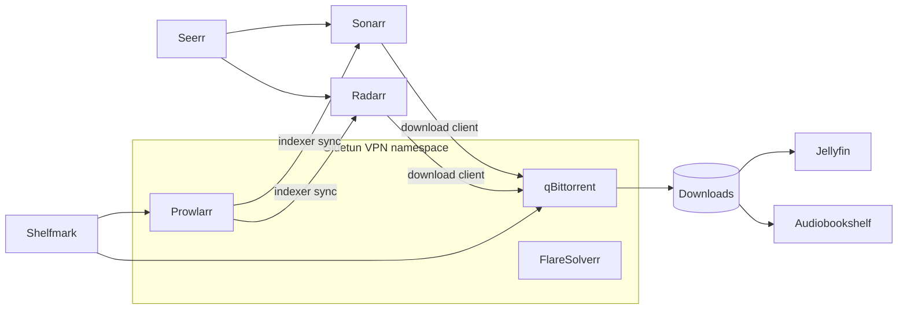

# Services

22 containers across five stacks. "Host port" is what the Mac publishes: `127.0.0.1` ports are reachable only from the Mac itself (Ansible uses them); everything else goes through Traefik on 443.

## Networking

| Service | Image | Host port | Role |
|---------|-------|-----------|------|
| Traefik | `traefik` | 80, 443 | Reverse proxy, TLS (one wildcard cert), security headers, forward auth |
| AdGuard Home | `adguard/adguardhome` | 53, 853; UI on `127.0.0.1:3053`/`8053` | DNS with ad blocking and `*.domain` rewrite; DNS-over-HTTPS upstreams |
| cloudflared | `cloudflare/cloudflared` | none (outbound) | Cloudflare Tunnel for the three public apps. Profile `tunnel` |

## Auth

| Service | Image | Host port | Role |
|---------|-------|-----------|------|
| Authelia | `authelia/authelia:4.39` | none | Login with two-factor for admin pages, via Traefik forward auth |

## Management

| Service | Image | Host port | Role |
|---------|-------|-----------|------|
| Homepage | `ghcr.io/gethomepage/homepage:v2` | none | Start page with status and live widgets |
| Portainer | `portainer/portainer-ce` | `127.0.0.1:9000` | Container management UI |
| Uptime Kuma | `louislam/uptime-kuma:1` | `127.0.0.1:3001` | HTTP monitors for every service, Telegram alerts |
| Dozzle | `amir20/dozzle` | `127.0.0.1:9999` | Live container logs |
| Watchtower | `containrrr/watchtower` | none | Automatic image updates, Telegram notifications |

## Media

| Service | Image | Host port | Profile | Role |
|---------|-------|-----------|---------|------|
| Gluetun (`vpn`) | `qmcgaw/gluetun` | 6881 (torrents); `127.0.0.1` for the services inside it | media, audiobooks | PIA VPN with port forwarding; network namespace for the services below |
| qBittorrent | `linuxserver/qbittorrent` | via `vpn`: `127.0.0.1:5080` | media, audiobooks | Torrent client, VPN only |
| Prowlarr | `linuxserver/prowlarr` | via `vpn`: `127.0.0.1:9696` | media, audiobooks | Indexer manager, syncs to Sonarr and Radarr |
| FlareSolverr | `flaresolverr/flaresolverr` | via `vpn`: `127.0.0.1:8191` | media, audiobooks | Solves Cloudflare challenges for indexers |
| Sonarr | `linuxserver/sonarr` | `127.0.0.1:8989` | media | TV shows |
| Radarr | `linuxserver/radarr` | `127.0.0.1:7878` | media | Movies |
| Jellyfin | `linuxserver/jellyfin` | 8096, 7359, 8920 | media | Media server (public via tunnel) |
| Seerr | `ghcr.io/seerr-team/seerr` | `127.0.0.1:5055` | media | Requests: home network and Tailscale only; family use it through Jellyfin's Moonbase plugin |
| Shelfmark | `ghcr.io/calibrain/shelfmark` | `127.0.0.1:8084` | audiobooks | Audiobook search and download |
| Audiobookshelf | `ghcr.io/advplyr/audiobookshelf` | 13378 | audiobooks | Audiobook server (public via tunnel) |
| Recommendarr | `tannermiddleton/recommendarr` | `127.0.0.1:3000` | recommendarr | AI recommendations from your library |

## Automation

| Service | Image | Host port | Role |
|---------|-------|-----------|------|
| Semaphore | `semaphoreui/semaphore` | `127.0.0.1:3010` | Web UI for running the Ansible playbooks |
| PostgreSQL | `postgres:16-alpine` | none | Semaphore's database (major version pinned) |

## How they connect

All of these connections are set up by Ansible roles, not by hand: see [Operations](operations.md#ansible-roles).
